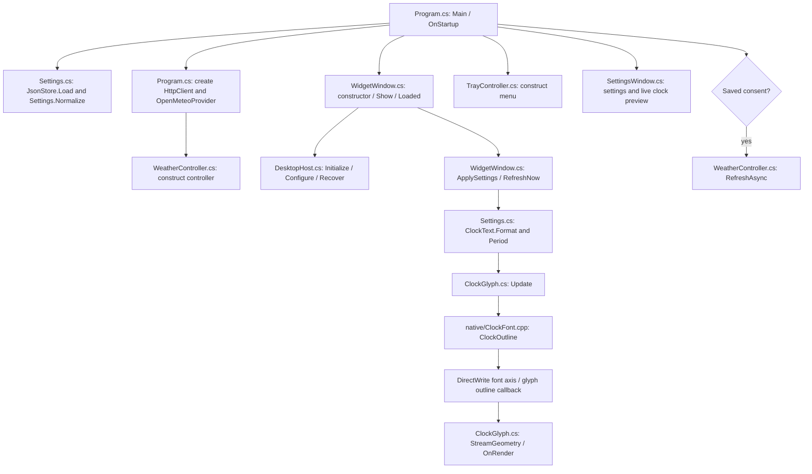
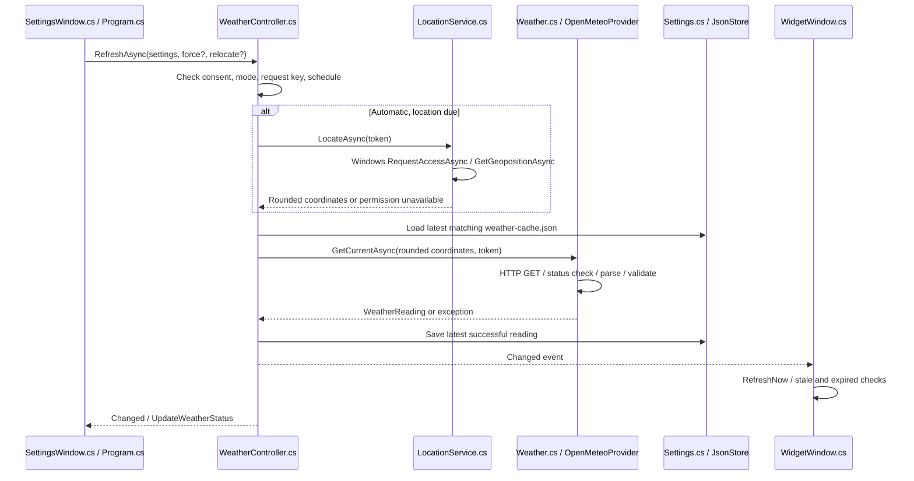
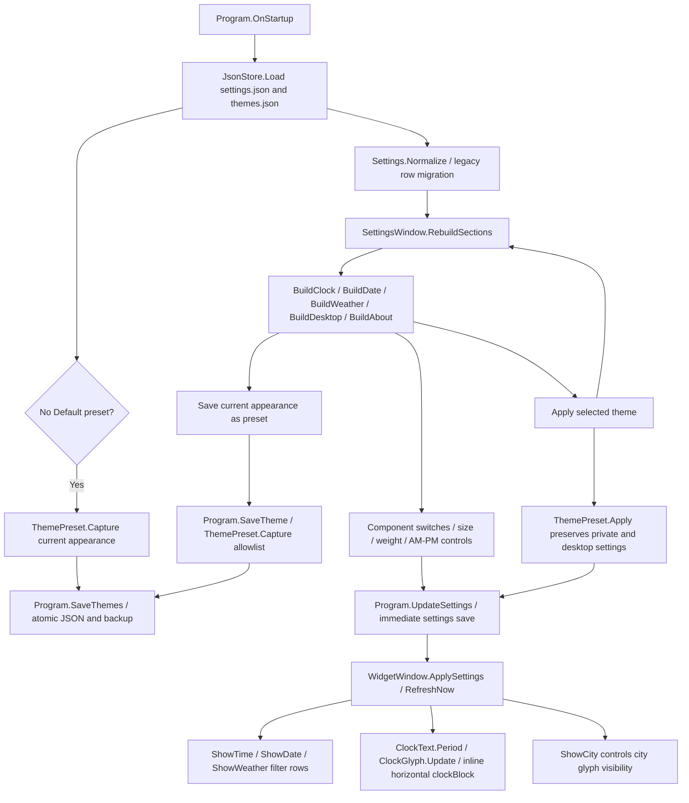
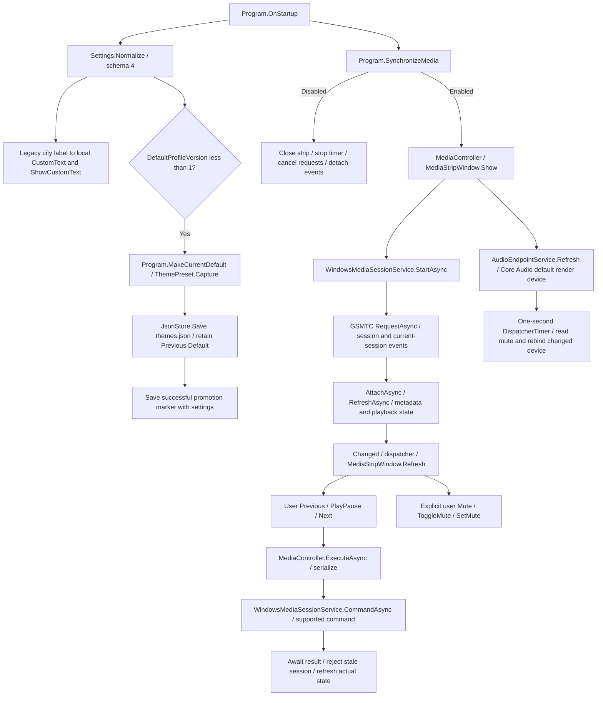

# Execution flow between files

Update this document whenever entry points, responsibilities, asynchronous boundaries, or failure paths change. Paths are relative to the repository root. The app uses code-built WPF views, not XAML pages.

## Startup and clock



`Program.Main` is STA. A named mutex prevents a second normal instance; a second launch signals a named event so the running instance reveals the clock and opens settings. Corrupt/missing settings fall back to defaults. `WidgetWindow` creates a top-level transparent layered window and establishes its native handle before desktop z-order placement. It is never parented to Explorer. Initial positioning uses physical screen pixels; content/font sizes use WPF DIP. Saved positions are checked against current displays.

The one-second dispatcher timer calls `RefreshNow`, formatting **current system time** on each tick rather than accumulating elapsed ticks. `ClockGlyph.Update` skips native work when the text/font/axis/size signature is unchanged. `ClockOutline` runs synchronously on the UI thread; it creates the selected variable font instance, calculates stable digit advances, and emits figure/line/bezier commands through the C ABI callback. `ClockGlyph` freezes the resulting geometry; `OnRender` paints it with the chosen foreground. The stacked layout feeds separate hour/minute/optional-second strings to glyph controls.

## Settings, tray, and persistence

```mermaid
sequenceDiagram
    participant User
    participant UI as SettingsWindow.cs / TrayController.cs
    participant App as Program.cs
    participant Widget as WidgetWindow.cs
    participant Host as DesktopHost.cs
    participant Store as Settings.cs / JsonStore
    User->>UI: Change appearance or desktop option
    UI->>App: UpdateSettings(new record)
    App->>App: Normalize; update startup registration if changed
    App->>Widget: ApplySettings
    Widget->>Host: Configure modes
    Widget->>Widget: RefreshNow / UpdateLayout
    App->>UI: Refresh tray checks
    App->>Store: Save(settings.json) immediately
    Store->>Store: Serialize/flush temp; preserve valid backup; replace primary
```

These operations run on the WPF dispatcher. `SettingsTheme.Create` supplies original dark WPF templates; the settings sidebar hosts normal WPF tabs and controls. `SettingsWindow.BuildPreview` uses a VisualBrush of the real clock content, so font/layout/color changes appear immediately. SettingsChanged synchronizes switches, visibility label, preview opacity, city label and save status. Launch-at-sign-in updates HKCU through `StartupRegistration.Set`; failure restores the previous setting and explains the error. Storage failures set `Program.StorageStatus`, the footer and tray tooltip. Every settings change writes immediately. JsonStore.Load tries primary then backup; Save flushes a temporary file, keeps a valid previous primary as .bak, and replaces the primary. Preview/non-started test applications never write personal settings.

Date/weather/city are ClockGlyph instances using ShapedText: ClockGlyph.Update calls native TextOutline, which builds the bundled font collection, sets the wght axis on IDWriteTextLayout4, and returns shaped glyph outlines through TextRenderer/OutlineSink. Time continues to use ClockOutline's tabular-digit path. Weather city uses Settings.City or WeatherController.LocationName and its own line above the temperature.

Display selection calls Program.SelectDisplay → UpdateSettings → SynchronizeDisplays → DisplayService.Resolve/Available. The main widget moves to the selected monitor; AllDisplays creates/removes independent WidgetWindow mirrors for other devices, sharing settings/weather. RestorePosition and SavePosition keep per-device coordinates in DisplayPositions, retaining legacy X/Y compatibility. Missing devices fall back to the primary. Every drag stage checks lock/click-through, capture is canceled on lock/loss, and DesktopHost's HWND hook blocks native SC_MOVE when locked.

The header's single Show/Hide button calls Program.ToggleClockVisibility, persists ClockVisible, and shows/hides all clocks. When showing, RevealClock → WidgetWindow.Reveal → DesktopHost.Reveal temporarily raises them for five seconds; regular recovery returns to desktop z-order. SettingsChanged changes the button label. Deliberately hidden windows suppress recovery. There are no duplicate preview-side actions. Closing settings flushes preferences and briefly reveals still-enabled clocks; it never exits the application or un-hides explicitly hidden clocks.

## Location, HTTP, cache, and UI updates



Async HTTP and WinRT calls do not block the UI. Await continuations preserve the caller's synchronization context; views also guard event updates with their dispatcher. Automatic consent starts from a visible settings window and passes `requestPermission: true` to `RefreshAsync`/`LocateAsync`. Startup/hourly/resume calls reuse the existing Windows grant rather than requesting permission while in the background. Permission denial produces a manual-city message. City search goes from `SettingsWindow` directly to `IWeatherProvider.SearchAsync`; selecting a result updates settings through `Program.UpdateSettings`.

`WeatherController` cancels superseded requests and ignores canceled results. One in-flight refresh is retained; ordinary timer calls respect the 30-minute schedule. Automatic location is reused for one hour; resume forces relocation. Coordinate changes discard mismatched readings. HTTP/parse/location failures retain only a valid matching cache, with a quiet status. Rendering labels a reading stale after one hour and hides it at 24 hours. ShowWeather=false cancels work and pauses refreshes while retaining city/consent. The explicit clear-location action cancels work, clears the reading, deletes cache/backups and clears saved coordinates/consent. The clock is independent of this pipeline.

## Shell recovery, resume, and shutdown

`WidgetWindow`'s 500-ms recovery timer calls `DesktopHost.Recover`. It finds the visible top-level desktop icon surface and places only our own HWND directly above it and below normal applications. No SetParent call, wallpaper-host message, child-window style, or HWND_BOTTOM placement is used. Explorer restarts cannot destroy the clock as a child; recovery finds the replacement desktop surface. `Program.OnWidgetClosed` can recreate an unexpectedly closed widget; explicit shutdown suppresses recreation. No Explorer-owned window is hidden or modified.

`SystemEvents.PowerModeChanged` arrives on a system thread. `Program.OnPowerChanged` dispatches clock refresh and forced location/weather refresh to WPF. Display changes likewise dispatch `WidgetWindow.RecoverDisplay` to refresh z-order/check bounds/save the recovered position. Each tick derives the date/time again, covering manual clock or timezone changes.

Tray Exit calls `Program.Shutdown`, then `OnExit`: unsubscribe system events, save settings, cancel/dispose weather work, remove the tray icon, stop all clock/mirror timers, dispose HTTP, named event/wait registration, and the instance mutex. Widget OnClosing blocks ordinary close requests while the app is active; mirror removal and app exit explicitly permit closure. An unhandled UI exception displays an error and exits rather than silently continuing in inconsistent state.

## Tests, preview, and packaging

- `tests/ClockWidget.Tests/Program.cs` runs core, native-outline, HTTP fixture, consent, location fallback, and cache tests. It uses its own disposable data folders and never requests real location.
- `Program --preview --output <absolute PNG>` renders a deterministic clock/illustrative weather preview through the real UI and font renderer, without settings writes, network, tray, or location access. It reads no personal settings. `--settings-preview` renders the redesigned settings panel. `--desktop-probe` checks mode flags, top-level/visible state and an uncovered point inside a numeral after reveal; a JSON report accompanies the screenshot. `--font Inter`/`--stacked` select variants. `--session-dir <directory>` isolates an interactive QA profile from personal settings.
- `scripts/build-native.ps1` compiles `native/ClockFont.cpp` before the app build. Native DLL, original icon, fonts, and license texts are copied to build/publish outputs.
- `scripts/verify-licenses.ps1` verifies pinned font hashes, notices, dependency allowlist, and runtime version. `scripts/build.ps1` orchestrates build, tests, and optional self-contained ZIP packaging. Windows CI invokes the same scripts.
- `--lifecycle-probe --session-dir <isolated folder> --output <JSON>` invokes LifecycleProbe.RunAsync on this app's own windows. It checks header labels, display selection/mirrors, lock/UI/disk consistency, autosave/backups, and clock lifetime/ticking more than five seconds after settings closes. It requires an isolated profile and uses no weather/location.

## Component visibility and appearance presets (0.4)



Settings controls, rendering, theme capture/application and synchronous atomic JSON persistence run on the WPF UI thread. `themes.json` loads with the same `.bak` fallback as settings. Errors report through preset status/StorageStatus; failed writes are not reported as saved. Theme capture has an explicit allowlist in `src/ClockWidget.Core/ThemePreset.cs`. `ShowWeather` participates in WeatherController.RefreshAsync's request key; hiding cancels an in-flight request before returning, and existing cancellation guards prevent late results. Neither showing weather nor applying a theme creates consent. City search is still an explicit asynchronous provider call, with UI continuation and cancellation on settings closure. All switches off leaves an empty transparent widget while settings/tray stay available. `--time-format 12` enables deterministic inline-period preview QA.

## Shared side-panel realignment (0.4.1)

`SettingsWindow.BuildPreview` places a persistent Top center button in a DockPanel outside the preview ScrollViewer and tab content. On the UI thread its Click handler calls `Program.ResetPosition()` for every active widget, which calls `WidgetWindow.ResetPosition(false)` then `DesktopHost.PlaceOn(target screen, false)`, `Program.SavePosition` and `UpdateSettings`/atomic settings persistence. The existing working-area top-center offset is reused; selected section and lock state are preserved. The button stays available when switching any of the five tabs.

## Planned media component (not implemented)

See [MEDIA_CONTROLS.md](MEDIA_CONTROLS.md) for proposed file boundaries, async event/command handling and placement feasibility gates. None of those proposed files or media execution paths exists in 0.4.1; startup and shutdown above describe only the implemented app.

## Implemented Custom Text, Default promotion and media preview (0.5)

This section supersedes the earlier "not implemented" media note for the subset below. `NowPlayingWindow` and `IMediaStripHost` still do not exist.



Clock settings keep immediate atomic JSON persistence. `SettingsWindow.BuildWeather` writes CustomText independently of City; `WidgetWindow.RefreshNow` renders the message only when ShowCustomText is enabled. Text is still part of the weather row and follows its visibility/position/size/weight. Theme capture copies only the text visibility flag; message content stays private in settings.

`SettingsWindow.BuildMedia` changes MediaEnabled/MediaDisplayId through UpdateSettings. `Program.SynchronizeMedia` owns a single independent media controller/window; clock hide/lock and settings close do not dispose it. `MediaStripWindow.Align` uses physical screen working-area coordinates and a top-level topmost window above the taskbar. There is no taskbar injection or Explorer parenting. Display/resume events realign it. Fullscreen suppression is not implemented.

GSMTC requests await asynchronously with ten-second cancellation limits. Session callbacks dispatch onto WPF; revision/session guards reject outdated metadata and command completions. Commands do not optimistically toggle playback state. Only explicit clicks send playback/mute requests. `AudioEndpointService` owns COM references; device removal clears availability, and its next read attempts the current default endpoint. Disabling media or OnExit stops polling, detaches callbacks, cancels outstanding operations, closes the strip and releases COM resources. Settings/metadata remain separate; track information is never written to disk.

`--media-probe --session-dir ... --output ...` is an isolated read-only integration path through MediaProbe.RunAsync. It checks session/audio availability and toolbar lifetime without playback/mute commands or metadata output. `--preview --media-preview --output ...` renders fixture-only media, without accessing real sessions/audio. These paths currently cannot execute in the blocked review output; presence of a probe is not a passing result.

## Current execution boundary

The normal self-contained 0.5 media preview also fails to start under Windows publisher verification; no current media screenshot/probe result exists. `docs/SIGNING.md` describes the required release signing path. The running installation remains 0.4.1, with Default refreshed locally from its existing settings. All 0.5 code paths above describe implemented source; they are not a claim that Windows has executed them successfully.

## Signing preparation

Directory.Build.props supplies the shared version and product metadata. scripts/build-native.ps1 reads that version, compiles an original VERSIONINFO resource and links it into ClockFont.dll before import verification. This adds publisher-facing file metadata, not a trusted signature. Windows CI still builds/tests/checks notices before producing artifacts. Code-signing integration is pending free-program approval; docs/CODE_SIGNING_POLICY.md records the manual release-approval boundary.

## Widgets branding compatibility

The application assembly name is Widgets and the shared product name is Widgets. Project/source paths, ClockWidget.Core.dll, ClockFont.dll, the existing local profile and named single-instance objects remain unchanged to retain compatibility. scripts/build.ps1 packages Widgets-win-x64.zip; verify-licenses.ps1 reads Widgets.runtimeconfig.json and Widgets.deps.json. Branding changes do not establish a publisher signature.

Managed informational versions omit the automatic Git revision suffix so their ProductVersion matches the native VERSIONINFO value. Build provenance remains recorded by the GitHub CI commit/run and release tag; the initial unsigned preview retains its original metadata and is not presented as signed.

## Optional local Sandbox trial (2026-10-23)

The prepared local `artifacts/Widgets-Media-Trial/Try Widgets Media.wsb` maps only its Payload read-only into `C:\WidgetsMediaTrial` in the guest. Its logon command invokes `Payload/Start-Trial.cmd`, which checks the default Sandbox account, copies the synthetic trial settings into the guest's local app-data folder and starts `App/Widgets.exe --session-dir <guest profile>`. Program.OnStartup then uses its existing isolated-profile path with MediaEnabled=true and weather consent off. Host preferences and media sessions are not shared. The files are ignored local trial artifacts, not distributed application files. Optional-feature installation succeeded but needs a host restart before this execution path can be tried; it has not run yet.
