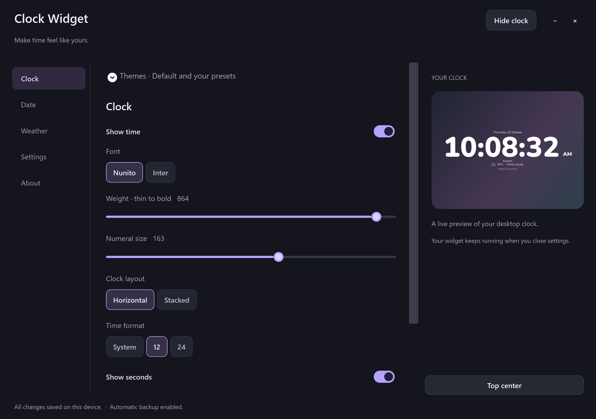

# Widgets

An original Windows 11 widgets app with a customizable clock, date, weather, local themes and optional media controls. Widgets is designed to grow over time, with additional small desktop widgets, more customization options and other improvements planned for future updates. These additions are a roadmap, not features available in the current preview.

Version 0.5 adds Custom Text, updated Default appearance, and an optional first media toolbar. Version 0.4 added Clock, Date, Weather, Settings and About sections; independent time/date/weather/city visibility; inline resizable AM/PM; and saved appearance themes. Display selection, movement lock and immediate autosave remain available.



*Rendered by the real app. New defaults use the chosen larger Nunito clock, weight 864, size 163, with seconds. Weather/time are illustrative; the widget background is transparent.*



*Screenshots show the last runnable version. The 0.5 Custom Text/media UI could not be rendered because Windows blocked its unsigned components. See [publisher-signing status](docs/SIGNING.md).*

## Features

- Large rounded numerals; Nunito and Inter with a genuine 200–900 weight slider.
- Horizontal or stacked time, 12/24-hour format, optional seconds, adjustable size/color/opacity/shadow/spacing.
- Date and weather above/below the clock or hidden independently.
- Separate size and real variable-weight sliders for date and weather/city text.
- Choose a connected display or show a clock on every display; each remembers its position.
- Desktop placement behind app windows, drag across monitors, center presets, lock, click-through, and optional always-on-top.
- Tray controls; local settings; optional launch at sign-in.
- Consent-based automatic Windows location or city search; °C/°F; cached weather while offline.

## Run

Extract the **complete** `Widgets-win-x64.zip` into a folder and launch `Widgets.exe`. No separate .NET installation is needed for that self-contained package. Do not move only the executable: its DLLs, fonts, and notices are required.

The clock starts near the top center, with settings open. The persistent right-side **Top center** button realigns it from any settings section. Drag to move it, right-click for settings, or double-click its tray icon. The single header button reads **Hide clock** while shown and **Show clock** while hidden. Showing briefly brings the clock above apps before returning to desktop order. Closing settings keeps the clock running; only **Exit** in the tray quits the app. **Settings → Clock display** moves it to your chosen screen; enable **Show clock on all connected displays** for mirrored clocks. Lock position prevents dragging but still allows explicit display/position commands.

All settings save automatically as soon as they change, including size/weight, seconds, display, lock, visibility and positions. No Save button or account is needed. Launching the app again reopens the existing instance. Weather stays off until you explicitly choose automatic location or a city in Settings → Weather.

The clock stays a top-level transparent WPF window. Its z-order is maintained above the visible desktop surface and below regular applications; it is never nested in Explorer's wallpaper window. Shell layout changes still require compatibility checks. See [validation status](docs/VALIDATION.md) for observed results and remaining checks. Unsigned builds may receive Windows reputation prompts.

To uninstall: turn off launch at sign-in, exit from the tray, delete the extracted folder, and optionally delete `%LocalAppData%\ClockWidget`.

## Appearance themes and components

The sidebar starts with **Clock**, **Date** and **Weather**, each with its own visibility switch. Disable time for a date-only or weather-only widget. Weather includes a Custom Text switch/editor and city search. AM/PM appears beside the time in 12-hour mode, with its own visibility and size controls in Clock. Shared color, opacity, spacing and display behavior live in **Settings**, just above About.

Expand **Themes** in Clock to apply Default or save the current appearance under a named preset. The first 0.5 launch captures the current appearance as Default, keeping the old Default as Previous Default. Clock → Themes → Make current appearance Default can update it later. Fresh installs use Nunito 163/864, date and weather 29/745, with seconds. Saving the same custom name replaces that preset. Settings themselves still autosave without a button. Themes save in `themes.json` with backup recovery; they contain no actual city, coordinates, permissions, display identity, position or startup preference. Applying one never grants weather consent. Copy your private data folder for backup.

## Build and test

Prerequisites: Windows 11 x64, .NET SDK **10.0.402** (or compatible .NET 10 feature band), Visual Studio 2022/2025 C++ x64 build tools, and Windows 11 SDK. No third-party application NuGet packages or test framework are required. The official Windows SDK reference/projection pack is restored from NuGet.

```powershell
./scripts/build.ps1
./scripts/build.ps1 -Package
```

The first command builds and runs the executable test suite and license checks. The second also produces `artifacts/Widgets-win-x64.zip` and its SHA-256 file, using runtime 10.0.13. If this repository has a local SDK in `.tools/dotnet`, the script uses it and confines package/CLI caches to `.tools`. After a successful restore, `-NoRestore` skips the build restore (publishing may still restore runtime packs).

The previous 0.2 runner encountered a Windows Application Control restriction (0x800711C7). The current 0.4 suite passed all 36 checks in the review build; the standard test-output runner was subsequently blocked by Application Control. Local packaging explicitly skips that blocked runner and does not count it as another pass. Default builds/CI require the suite; an explicit `-SkipTests` is available only for documented local blockers, never as a passing result. No security policy is changed.

The fonts, original icon, and full notices are checked in: normal builds never download replacement artwork. `scripts/fetch-assets.ps1` is an explicit maintainer refresh operation; it downloads official upstream font assets and notices, updates source hashes, and requires review. `scripts/create-icon.ps1` recreates the original icon.

Offline preview using a built app:

```powershell
./src/ClockWidget/bin/Release/net10.0-windows10.0.19041.0/win-x64/Widgets.exe --preview --output "$PWD/docs/images/clock.png"
```

Add `--stacked` or `--font Inter` for variants. Preview does not read/write personal settings or use network/location. Add `--desktop-probe` to briefly test actual desktop attachment/mode toggles and save a JSON report beside the widget-only image. CI builds/tests/packages on Windows; version tags create a **draft** GitHub release for review.

## Privacy and weather terms

Settings and the latest weather reading are stored only in `%LocalAppData%\ClockWidget`. `settings.json.bak` preserves the previous valid settings and is loaded automatically if the primary is corrupt. To keep an external backup, copy this private folder; it can contain your city/rounded coordinates and should not be committed to GitHub. No app telemetry, account, ads, or app update checks. The Show weather switch hides the row and pauses refreshes while retaining your location choice. The separate clear-location action revokes app consent and deletes the location and weather cache/backups.

Optional custom text appears above the weather reading. **Weather → Show Custom Text** and **Custom Text** control your own message above the reading, independently of the forecast city. Selecting a forecast city never overwrites that text. Automatic location does not silently call a reverse-geocoding service.

Automatic weather asks Windows for location access, rounds coordinates to two decimals, and sends them directly to Open-Meteo. The provider also receives your IP address. City search sends the query to Open-Meteo's geocoding service, based on GeoNames. Windows and those services apply their own privacy policies.

Weather refreshes every 30 minutes. Automatic location is reacquired at startup/resume and hourly. Readings are labeled stale after an hour and hidden after 24 hours. Permission/network failures never stop the clock.

Weather data by [Open-Meteo](https://open-meteo.com/), [CC BY 4.0](https://creativecommons.org/licenses/by/4.0/); city data based on [GeoNames](https://www.geonames.org/). Temperatures are rounded/optionally converted; weather codes become descriptive labels and original icons. Free hosted API access is for **noncommercial use** under [provider terms](https://open-meteo.com/en/terms). Commercial forks need an appropriate provider arrangement. The app code remains MIT-licensed.

## License and contribution

Original code, docs, and artwork: **MIT**, copyright © 2026 Saqib Hussain. Bundled fonts remain **SIL OFL 1.1**. Runtime/projection binaries retain their upstream distribution terms. Read [third-party notices](THIRD-PARTY-NOTICES.md) and the [component inventory](licenses/INVENTORY.md); no claim is made that Windows or Microsoft build tools are open source.

Contributions should include only original work or material with verified compatible reuse permissions. Include source/version/license/obligations for new dependencies or assets, preserve all notices, and update the dependency allowlist only after review. Run `scripts/build.ps1`, keep [decisions.md](decisions.md) and [Flow.md](Flow.md) synchronized, and describe validation in your pull request. Do not submit personal settings, coordinates, API secrets, or build outputs. No contributor license agreement is required; original contributions are offered under the project's MIT license.

Project owner: [saqibhussaen](https://github.com/saqibhussaen). Repository-local author identity uses the owner's GitHub noreply address; private settings, credentials and build outputs are excluded from Git.

## Media controls preview (0.5)

Enable **Media → Enable media controls** for a separate toolbar above the taskbar with Previous, Play/Pause, Next, system Mute and a player picker. Mute affects the default Windows audio output, not just the selected player. Unsupported commands are disabled. The toolbar stays independent of clock visibility and closes when media is disabled. No titles or listening history are saved.

This is an initial implementation: exact in-taskbar placement, artwork panel, volume slider and fullscreen suppression are unfinished. Current live execution is blocked by Windows Application Control in both review and self-contained preview outputs; compatibility has not been established. [Media plan and status](MEDIA_CONTROLS.md).

## Code signing policy

We submitted an application for free SignPath Foundation signing on 2026-10-22; approval is pending and current artifacts are unsigned. Read the [Code signing policy](docs/CODE_SIGNING_POLICY.md), [privacy policy](docs/PRIVACY.md), and [publisher-signing status](docs/SIGNING.md). No signed release or immediate Windows unblock is promised.
